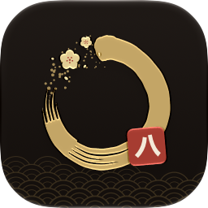
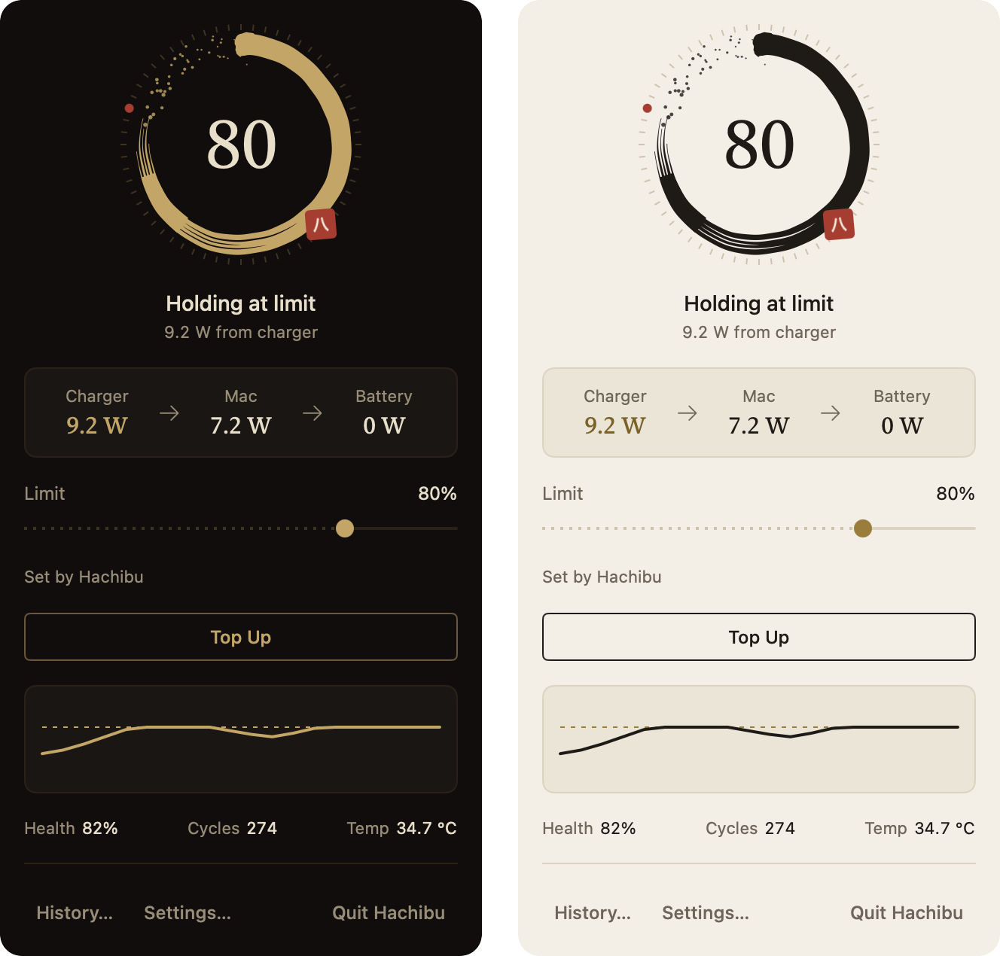
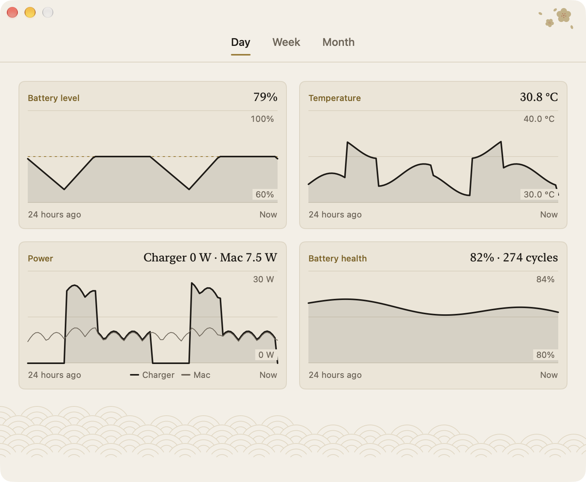
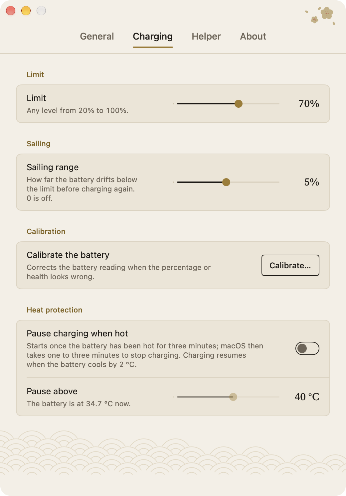

<p align="center">
  
</p>

<h1 align="center">Hachibu</h1>

<p align="center">
  <strong>Keep your MacBook's battery at the charge limit you choose.</strong><br>
  A native menu bar app for macOS 27.
</p>

<p align="center">
  
  
  
  
</p>

<p align="center">
  
</p>

The name comes from *hara hachi bu*: eat until you are eight parts full.
A battery kept below full lasts longer, so Hachibu stops charging before
it gets there.

Hachibu runs on your Mac only. It has no account and no server, and it
sends nothing anywhere.

## Features

| | |
| --- | --- |
| **Charge limit** | Pick any limit from 20% to 100%. A limit is shown as set only after macOS reports that it holds it. |
| **Top Up** | Charge to 100% once, for a day away from the charger. Your limit returns when you unplug or press Stop. |
| **Sailing** | Let the battery drift a few percent below the limit before it charges again, instead of topping up all day. |
| **Heat protection** | Pause charging when the battery is hot (40 °C by default) and resume when it has cooled. |
| **Calibration** | A guided cycle meant to correct the percentage and health readings: drain to 15%, charge to 100%, rest for two hours. Whether it changes the readings has not been measured yet. |
| **History** | Level, temperature, power, and health over a day, a week, or a month. |
| **Notifications** | When the limit is not holding, when macOS starts a full charge of its own, and when a Top Up or a calibration finishes. Each can be switched off. |

Limits below 80%, sailing, heat protection, and calibration need the
[helper](#how-it-controls-charging). Without it, Hachibu sets macOS's own
limits (80 to 100%) and runs Top Up.

## Screenshots

<p align="center">
  <picture>
    <source media="(prefers-color-scheme: dark)" srcset="docs/images/history-dark.png">
    
  </picture>
</p>

<p align="center">
  <picture>
    <source media="(prefers-color-scheme: dark)" srcset="docs/images/settings-dark.png">
    
  </picture>
</p>

The pictures show sample data, not a real battery.

## Requirements

- An Apple silicon MacBook running **macOS 27**.
- Developed and tested on one Mac, a MacBook Air (M1). Other models
  should behave the same way but have not been tried.
- Intel Macs and earlier versions of macOS are not supported. The way
  charging is controlled changed in macOS 27, and Hachibu only knows the
  new way. The app opens on macOS 26, where it has never been tried.

## Install

There is no packaged download yet. Build it from source with one
command:

```bash
./build.sh --open
```

This builds a release, signs it, installs `~/Applications/Hachibu.app`,
and opens it. You need Xcode 26 or later. There is no Xcode project; it
is a Swift package.

How the build is signed decides what works:

| Signing | What you get |
| --- | --- |
| None (ad hoc) | macOS's own limits, 80 to 100%, and Top Up. The helper cannot be installed. |
| Apple Development certificate | Everything, on your own Mac. |
| Developer ID certificate | Everything, and a build you can give to others. `./build.sh --notarize` also sends it to Apple's notary. |

## How it controls charging

Hachibu never switches charging on or off itself. It asks macOS to hold
a limit, in one of two ways.

**1. macOS's own limit, no helper.** macOS 27 offers limits of 80, 85,
90, 95, and 100%. Hachibu sets these through the same private system
framework (PowerUI) that System Settings uses. They take effect at once.

**2. Any limit from 20%, with the helper.** For limits macOS does not
offer, a small helper that runs as root writes the limit into macOS's
charging settings, and macOS enforces it within a few minutes (26 to 90
seconds when measured here). You install the helper from Settings >
Helper and approve it once in System Settings > General > Login Items.

The helper accepts three requests and nothing else: set a limit,
reconnect the charger, report its status. It listens only to a copy of
Hachibu signed by the same Apple developer team as the helper itself.

### Good to know

- With the limit below the current level and the charger connected,
  macOS drains the battery down to the limit by itself. That drain
  appears to stop while the Mac sleeps.
- macOS starts charging again once the level is more than about 5%
  below the limit.
- From time to time macOS charges to 100% on its own to keep its
  estimates accurate. Hachibu cannot stop that; it tells you when it
  happens.
- On battery, macOS sets the limit aside and takes it up again when the
  charger is connected.
- Hachibu does not cut the charger, and the helper cannot. An earlier
  version tried this for a "discharge" mode; on macOS 27 it could leave
  the Mac running on battery while plugged in, so it was removed.
- Hachibu never keeps the Mac awake.
- Both ways rely on parts of macOS that Apple does not document, and a
  macOS update can break them. When a limit is not being held, Hachibu
  says so instead of showing the limit you asked for.

## Development

```bash
swift test --scratch-path ~/Library/Developer/Hachibu/test-build
```

```bash
tools/selftest.sh
```

- [`ARCHITECTURE.md`](ARCHITECTURE.md): who decides and who acts.
- [`CLAUDE.md`](CLAUDE.md): the layout of the code, the checks, and the
  design rules.
- [`design/KIT.md`](design/KIT.md): the design kit.
- [`docs/research/charge-control.md`](docs/research/charge-control.md):
  what was measured about charging on macOS 27.

## Uninstall

1. In Hachibu, open Settings > Helper and click **Remove Helper…**. A
   limit macOS does not offer by itself moves up to the next one it does
   (60% becomes 80%, 82% becomes 85%), so nothing is left that only the
   helper set.
2. In Settings > General, switch off **Open at login**.
3. Quit Hachibu and delete `~/Applications/Hachibu.app`.
4. To also remove your choices and history, delete
   `~/Library/Application Support/Hachibu` and run:

```bash
defaults delete app.hachibu.mac
```

The charge limit itself is a macOS setting. After uninstalling you can
change it in System Settings > Battery.

## Credits

The method for setting a charge limit on macOS 27 was worked out and
published by the [batt](https://github.com/charlie0129/batt) project.
Hachibu's code is its own, but it would not exist without what batt
documented.

Designed and built by Mohamed Hammad.

## License

[MIT](LICENSE)
